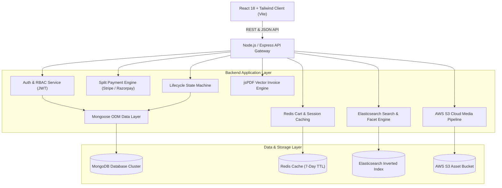
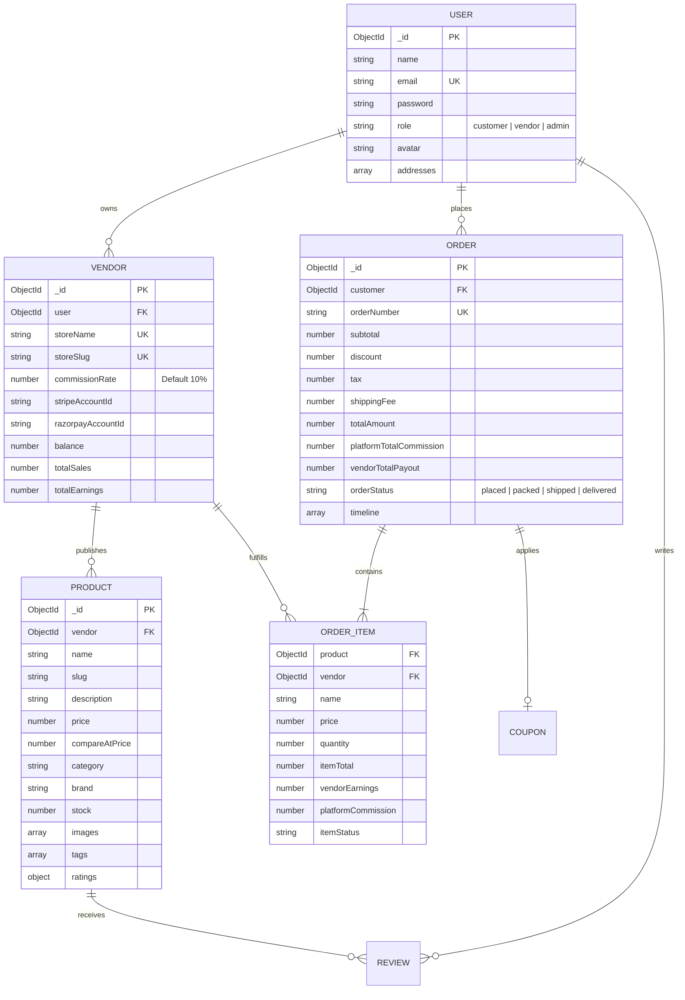
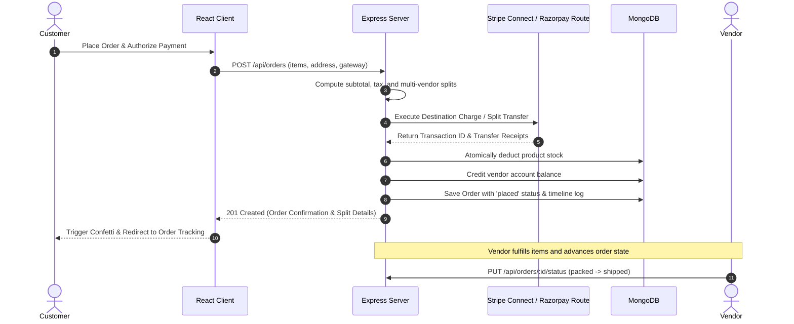

# NexviaMart Multi-Vendor Architecture & Data Design

## 1. Executive System Overview
NexviaMart is an enterprise-grade multi-vendor e-commerce platform designed with an Amazon-style architecture. The system decouples customer shopping, vendor catalog administration, and platform governance while automating real-time payment splitting, platform commission retention, and order fulfillment tracking.



---

## 2. Database-First (DB-First) Architecture & Relational Data Schema

The data layer is built using a **Database-First (DB-First)** paradigm:

1. **Database as Single Source of Truth:**
   - The native database schema is defined as MongoDB DDL commands and `$jsonSchema` validators in [`server/src/db/schemas.js`](../server/src/db/schemas.js) and [`server/scripts/schema.mongodb.js`](../server/scripts/schema.mongodb.js).
   - Collections, validators, and native indexes (unique constraints, compound indexes, text search) are created directly at the database engine level via `db.createCollection(name, { validator: spec.validator })`.
   - Native schema migration can be executed anytime via:
     ```bash
     cd server
     npm run db:init
     ```
   - Or open [`server/scripts/schema.mongodb.js`](../server/scripts/schema.mongodb.js) directly inside MongoDB Compass `_mongosh`.

2. **Application Layer Integration:**
   - Mongoose models operate in DB-First mode (`autoCreate: false`, `autoIndex: false`), consuming the existing database structure rather than driving it lazily.
   - Pre-save hooks automatically hash user passwords using BCrypt and generate URL-safe slugs for vendor storefronts and products.
   - Instance methods like `comparePassword` encapsulate authentication logic directly on user documents.



---

## 3. Split Payment & Commission Data Flow



---

## 4. Key Performance Architectural Decisions
1. **Clean Mongoose ODM Modeling:** Schemas define strict validation, defaults, and relations without unnecessary DDL boilerplate, making the codebase maintainable and readable.
2. **Elasticsearch Faceted Querying:** Offloads intensive full-text search, spelling fuzzy matches, and category aggregations from MongoDB to an inverted index, ensuring sub-50ms response times.
3. **Redis Session & Cart Store:** Bypasses disk I/O for frequent cart reads, updates, and guest session lookups with a 7-day TTL and sub-2ms response latency.
4. **Automated Zero-Config Fallback:** For testing environments where external Redis, Elasticsearch, or AWS S3 instances are not provisioned, built-in in-memory adapters provide identical API methods, ensuring 100% test reliability.
